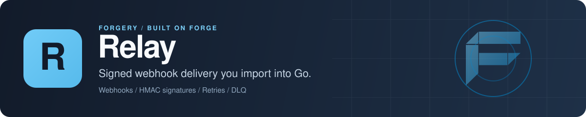

<p align="center">
  
</p>

# Relay: webhook delivery engine for Go

Relay is a Go library for sending webhooks to your customers. You register event types (optionally with a JSON Schema), your tenants register endpoints, and Relay fans each event out to the matching endpoints, signs every delivery with HMAC-SHA256, retries failures with exponential backoff, rate-limits per endpoint, and parks permanent failures in a dead letter queue you can replay. It runs inside your process on PostgreSQL, SQLite, MongoDB, Redis or memory, and it ships an extension for [Forge](https://github.com/xraph/forge) with an admin API.

[](https://go.dev/dl/) [](https://github.com/xraph/relay/actions/workflows/ci.yml) [](https://pkg.go.dev/github.com/xraph/relay) [](https://github.com/xraph/relay/stargazers)

[Documentation](https://www.xraph.com/docs/relay) · [Quick start](#quick-start) · [Features](#why-relay) · [Verify a webhook](#verify-a-webhook) · [Stores](#pick-a-store) · [Forge](#use-it-with-forge) · [Examples](#examples) · [FAQ](#faq)

## Quick start

You need [Go 1.26 or later](https://go.dev/dl/).

```bash
go get github.com/xraph/relay@latest
```

This program runs Relay on the in-memory store and sends one event to a local receiver, which checks the signature the way your customer's code would:

```go
package main

import (
	"context"
	"fmt"
	"io"
	"log"
	"net/http"
	"net/http/httptest"
	"strconv"
	"time"

	"github.com/xraph/relay"
	"github.com/xraph/relay/catalog"
	"github.com/xraph/relay/endpoint"
	"github.com/xraph/relay/event"
	"github.com/xraph/relay/signature"
	"github.com/xraph/relay/store/memory"
)

func main() {
	ctx := context.Background()

	r, err := relay.New(relay.WithStore(memory.New()))
	if err != nil {
		log.Fatal(err)
	}

	if _, err := r.RegisterEventType(ctx, catalog.WebhookDefinition{
		Name:    "order.created",
		Version: "2025-01-01",
	}); err != nil {
		log.Fatal(err)
	}

	// A local receiver that checks the signature, standing in for your customer.
	var secret string
	received := make(chan struct{})
	receiver := httptest.NewServer(http.HandlerFunc(func(w http.ResponseWriter, req *http.Request) {
		body, _ := io.ReadAll(req.Body)
		ts, _ := strconv.ParseInt(req.Header.Get("X-Relay-Timestamp"), 10, 64)
		ok := signature.Verify(body, secret, ts, req.Header.Get("X-Relay-Signature"))
		fmt.Printf("%s %s signature ok=%v\n", req.Header.Get("X-Relay-Event-Type"), body, ok)
		w.WriteHeader(http.StatusOK)
		close(received)
	}))
	defer receiver.Close()

	ep, err := r.Endpoints().Create(ctx, endpoint.Input{
		TenantID:   "acme",
		URL:        receiver.URL,
		EventTypes: []string{"order.*"},
	})
	if err != nil {
		log.Fatal(err)
	}
	secret = ep.Secret // generated for you when Input.Secret is empty

	r.Start(ctx)
	defer r.Stop(ctx)

	if err := r.Send(ctx, &event.Event{
		Type:     "order.created",
		TenantID: "acme",
		Data:     map[string]any{"order_id": "ORD-001", "total_cents": 9999},
	}); err != nil {
		log.Fatal(err)
	}

	select {
	case <-received:
	case <-time.After(5 * time.Second):
		log.Fatal("no delivery")
	}
}
```

Run it with `go run .`:

```text
order.created {"order_id":"ORD-001","total_cents":9999} signature ok=true
```

`Send` checks that the event type exists and isn't deprecated, validates the payload against the type's schema if it has one, stores the event, and queues one delivery for every enabled endpoint of that tenant whose patterns match. It does not wait for the HTTP call, so your request handler returns as soon as the event is stored. The delivery engine you started with `Start` picks the work up. `Stop` cancels the engine's context and waits for its workers to return.

## Why Relay?

Sending one webhook is a `http.Post`. Sending them to hundreds of customer endpoints, some down, some slow, some returning 500 for a week, takes a queue, a retry policy, a signing scheme and a replay tool, and you would have to build and run all of that before your first customer could subscribe. You get those pieces from Relay. You call it from the service that already owns your events.

| You need | Relay gives you |
| --- | --- |
| A catalog of event types | `RegisterEventType` with a name, version, group and optional JSON Schema; deprecated types are refused at `Send` |
| Tenant-scoped endpoints | `Endpoints()` to create, update, enable, disable and delete endpoints, each owned by one tenant, with glob patterns like `order.*` or `*` |
| Signed deliveries | HMAC-SHA256 over `{timestamp}.{body}`, sent as `X-Relay-Signature: v1=<hex>`, with a secret generated per endpoint and `RotateSecret` to change it |
| Retries that make sense | Exponential backoff (5s, 30s, 2m, 15m, 2h by default), retries on 5xx, 429 and network errors, straight to the DLQ on other 4xx |
| Dead endpoints handled | A 410 Gone disables the endpoint |
| Replay | A dead letter queue with `Replay`, `ReplayBulk` over a time range, and `Purge` |
| Backpressure on receivers | A token bucket per endpoint, set as deliveries per second on `endpoint.Input.RateLimit` |
| Safe retries from your own producer | `IdempotencyKey` on `Send`, or `SendReliable` with content-bound receipts on memory and PostgreSQL ([RELIABILITY.md](RELIABILITY.md)) |
| Visibility | A trace per delivery attempt with the endpoint URL redacted, and outcome, skip, timing and DLQ metrics with fixed labels through Forge's metrics ([observability docs](docs/content/docs/subsystems/observability.mdx)) |
| An admin API | HTTP handlers for event types, endpoints, events, deliveries, the DLQ and stats |

## Verify a webhook

Your customers verify deliveries with the `signature` package, or with any HMAC-SHA256 code in their own language. Read the raw body, then check it against the two headers:

```go
body, _ := io.ReadAll(r.Body)
ts, _ := strconv.ParseInt(r.Header.Get("X-Relay-Timestamp"), 10, 64)

if !signature.Verify(body, endpointSecret, ts, r.Header.Get("X-Relay-Signature")) {
	http.Error(w, "invalid signature", http.StatusUnauthorized)
	return
}
```

Every delivery is a `POST` with these headers, plus any custom headers you set on the endpoint:

| Header | Value |
| --- | --- |
| `X-Relay-Signature` | `v1=` and the hex HMAC-SHA256 of `{timestamp}.{body}` under the endpoint's secret |
| `X-Relay-Timestamp` | Unix seconds when the signature was made |
| `X-Relay-Event-ID` | The event's TypeID, such as `evt_01h6rz...` |
| `X-Relay-Event-Type` | The event type, such as `order.created` |
| `X-Relay-Delivery-ID` | The delivery's TypeID, the same across retries of one delivery |
| `Content-Type` | `application/json` |

`Verify` does not check how old the timestamp is. If you want replay protection, tell your customers to reject a timestamp more than a few minutes off their clock before they call it.

Relay refuses to sign with an empty secret, and `Verify` returns false for one. `Endpoints().Create` generates a secret whenever you don't pass one, so the only way to end up with an unsigned endpoint is to write one through the store directly. Deliveries to such an endpoint fail with `endpoint has no signing secret` and land in the DLQ after the retry schedule runs out. To find any, call `r.Endpoints().ListUnsigned(ctx, "")` (an empty tenant checks every tenant) and fix them with `RotateSecret`.

## Pick a store

`relay.New` needs a store, and returns `ErrNoStore` without one. Five ship with the module:

| Store | Package | Notes |
| --- | --- | --- |
| In-memory | `github.com/xraph/relay/store/memory` | Tests and local development; supports `SendReliable` |
| PostgreSQL | `github.com/xraph/relay/store/postgres` | Through Grove's `pgdriver`; atomic `Send`, `SendReliable`, and LISTEN/NOTIFY to wake the engine |
| SQLite | `github.com/xraph/relay/store/sqlite` | Through Grove's `sqlitedriver`; put `_pragma=busy_timeout(5000)` in the DSN, because ten workers write at once by default |
| MongoDB | `github.com/xraph/relay/store/mongo` | Through Grove's `mongodriver` |
| Redis | `github.com/xraph/relay/store/redis` | Through Grove's KV store and `redisdriver`; wakes the engine on new work |

The SQL and Mongo stores take a `*grove.DB` (`postgres.New(db)`), and Redis takes a `*kv.Store`. Call `Migrate` before you start Relay. For Redis it also builds the every-tenant endpoint index and checks that the KV store maps keys in a way Relay can follow, so you should check that error:

```go
rdb := redisdriver.New()
if err := rdb.Open(ctx, "redis://localhost:6379"); err != nil {
	log.Fatal(err)
}
kvStore, err := kv.Open(rdb)
if err != nil {
	log.Fatal(err)
}

store := redisstore.New(kvStore)
if err := store.Migrate(ctx); err != nil {
	log.Fatal(err)
}

r, err := relay.New(relay.WithStore(store))
```

If two Relay instances share one Redis, open each KV store with a namespace hook, `kv.WithHook(middleware.NewNamespace("app1"))` from `github.com/xraph/grove/kv/middleware`. Every key Relay touches then lands under that prefix, so both can use the same tenant IDs without seeing each other's rows. Each namespace needs its own `Migrate`. A hook that only covers reads, or only writes, makes `Migrate` fail with `ErrKVKeysInconsistent` before it writes anything.

Every backend runs the same conformance suites in `store/storetest`. If you write your own `store.Store`, you can run them against it too.

## Engine options

`relay.New` takes functional options:

| Option | Default | What it sets |
| --- | --- | --- |
| `WithStore(s)` | required | The store |
| `WithLogger(l)` | no-op logger | A `github.com/xraph/go-utils/log` logger |
| `WithConcurrency(n)` | `10` | Delivery workers |
| `WithPollInterval(d)` | `1s` | How often the engine looks for due deliveries |
| `WithMaxPollInterval(d)` | `30s` | The cap on the idle backoff, which doubles from the poll interval while polls come back empty |
| `WithBatchSize(n)` | `50` | Deliveries taken per poll |
| `WithRequestTimeout(d)` | `30s` | HTTP timeout per attempt |
| `WithHTTPClient(c)` | plain client | The client deliveries go out on, for example one whose dialer refuses private addresses. Relay wraps its transport in tracing, so don't pass one that's traced already |
| `WithMaxRetries(n)` | `5` | Attempts before a delivery goes to the DLQ |
| `WithRetrySchedule(s)` | `5s, 30s, 2m, 15m, 2h` | Waits between attempts; the last one repeats if you allow more attempts than entries |
| `WithShutdownTimeout(d)` | `30s` | Stored in `Config`, but the engine's `Stop` doesn't read it yet |
| `WithCacheTTL(d)` | `30s` | The catalog's in-memory cache; `0` turns it off |
| `WithMetrics(m)` | none | `observability.NewMetrics(factory)`. Spans go to the global tracer provider with no option; `WithTracer` is deprecated and does nothing |

## Use it with Forge

The `extension` package mounts Relay in a Forge app:

```go
import (
	"github.com/xraph/forge"
	relayext "github.com/xraph/relay/extension"
	"github.com/xraph/relay/store/memory"
)

cfg := relayext.DefaultConfig()
cfg.MaxRetries = 8

app := forge.NewApp(forge.AppConfig{
	Name: "orders",
	Extensions: []forge.Extension{
		relayext.New(
			relayext.WithConfig(cfg),
			relayext.WithStore(memory.New()),
		),
	},
})
```

Tune the engine through `WithConfig`, as above, and start from `DefaultConfig()`. `WithRelayOption(relay.WithMaxRetries(8))` looks like it should work, but it doesn't: the extension fills the embedded `relay.Config` with defaults and appends those options after yours, so the engine ends up with 5 retries. The same goes for concurrency, the poll intervals, batch size, request timeout, the retry schedule, the shutdown timeout and the cache TTL. Keep `WithRelayOption` for options `Config` doesn't carry, like `relay.WithHTTPClient` and `relay.WithLogger`. `WithConfig` replaces the whole config, so put it before `WithBasePath`, `WithGroveDatabase` and the other options that write into it.

During `Register` the extension picks a store, builds the engine with the app's logger and metrics, runs the store's migrations, mounts the admin API, and provides `*relay.Relay` to the container. Resolve it with `forge.Inject[*relay.Relay](app.Container())`. The app's `Start` and `Stop` start and stop the delivery engine, and the health check pings the store.

The store comes from the first of these that applies:

1. A `*grove.DB` from the container, with `WithGroveDatabase(name)` or `grove_database` (`""` means the default one). The driver picks the PostgreSQL, SQLite or Mongo store.
2. A `*kv.Store` from the container for the Redis store, with `WithGroveKV(name)` or `grove_kv`.
3. The default `*grove.DB` in the container, which the extension finds on its own when the Grove extension registered one.
4. `relayext.WithStore(s)`.

A store found through grove is passed to `relay.New` after the one from `WithStore`, so it wins, even when you never asked for grove. If you want your `WithStore` store in an app that also runs the Grove extension, don't register a default grove database.

There is no in-memory fallback. If you give it none of these, `Register` fails with `ErrNoStore`.

The admin API is mounted under the base path (`/relay` by default) plus `/v1`, so the routes are `/relay/v1/event-types`, `/relay/v1/endpoints`, `/relay/v1/endpoints/:endpointId/rotate-secret`, `/relay/v1/events`, `/relay/v1/dlq`, `/relay/v1/dlq/:dlqId/replay`, `/relay/v1/stats` and so on, all with OpenAPI metadata. Outside Forge, `api.NewHandler(r.Store(), r.Catalog(), r.Endpoints(), r.DLQ(), logger)` gives you the same routes as a plain `http.Handler` on Go's `ServeMux`.

The extension also registers a contract contributor for the [Forge dashboard](https://github.com/xraph/forge-dashboard), covering endpoints, events, deliveries, event types and the DLQ. [MIGRATION.md](MIGRATION.md) explains the move from the old templ dashboard.

## Configuration

The extension reads `extensions.relay` and falls back to a top-level `relay` key:

```yaml
extensions:
  relay:
    base_path: /relay
    disable_routes: false
    disable_migrate: false
    grove_database: ""   # named grove.DB in the container
    grove_kv: ""         # named kv.Store, for the Redis store
```

The matching options are `WithBasePath`, `WithDisableRoutes`, `WithDisableMigrate`, `WithGroveDatabase`, `WithGroveKV`, `WithConfig` and `WithRequireConfig`. Set the engine's own tuning (concurrency, retries, timeouts) in code, through the embedded `relay.Config` in `WithConfig`. Those fields carry no YAML tags today, so `max_retries`, `concurrency` and the rest are ignored in a config file, and `WithRelayOption` can't set them either (see above).

## Documentation

| If you want to | Read |
| --- | --- |
| Send a first webhook | [Getting started](https://www.xraph.com/docs/relay/getting-started), [full example](https://www.xraph.com/docs/relay/guides/full-example) |
| Understand the pipeline | [Architecture](https://www.xraph.com/docs/relay/architecture), [delivery](https://www.xraph.com/docs/relay/subsystems/delivery), [dead letter queue](https://www.xraph.com/docs/relay/subsystems/dlq) |
| Manage types and endpoints | [Catalog](https://www.xraph.com/docs/relay/subsystems/catalog), [endpoints](https://www.xraph.com/docs/relay/subsystems/endpoints), [rate limiting](https://www.xraph.com/docs/relay/subsystems/rate-limiting) |
| Help customers verify payloads | [Signatures](https://www.xraph.com/docs/relay/subsystems/signatures), [webhook verification guide](https://www.xraph.com/docs/relay/guides/webhook-verification) |
| Run it on a database | [PostgreSQL](https://www.xraph.com/docs/relay/stores/postgres), [SQLite](https://www.xraph.com/docs/relay/stores/sqlite), [MongoDB](https://www.xraph.com/docs/relay/stores/mongo), [Redis](https://www.xraph.com/docs/relay/stores/redis) |
| Mount it in Forge | [Forge extension guide](https://www.xraph.com/docs/relay/guides/forge-extension), [admin API](https://www.xraph.com/docs/relay/subsystems/admin-api) |

The Go API is on [pkg.go.dev](https://pkg.go.dev/github.com/xraph/relay). [RELIABILITY.md](RELIABILITY.md) is the caller's contract for `SendReliable`.

## Examples

| Example | What it shows |
| --- | --- |
| [basic](_examples/basic/) | Memory store, an event type, an endpoint, a send, and a local receiver |
| [dynamic-catalog](_examples/dynamic-catalog/) | Registering event types at runtime through the admin API |
| [stripe-style](_examples/stripe-style/) | A receiver that verifies HMAC-SHA256 signatures |

Go skips directories that start with an underscore, so `go test ./...` never builds these. You run one from the repo root with `go run ./_examples/basic`.

## FAQ

### How do I send webhooks from a Go service?

Create a `relay.Relay` with a store, register an event type, create an endpoint for each subscriber, call `Start`, then call `Send` with an `event.Event`. The [quick start](#quick-start) is a complete program.

### Does Relay retry failed webhooks?

Yes. If your customer's endpoint answers with a 5xx or a 429, or the request times out or can't connect, Relay retries the delivery on the backoff schedule (5s, 30s, 2m, 15m, 2h by default) until `MaxRetries` attempts are used up, and then the delivery goes to the dead letter queue. Any other 4xx goes to the DLQ straight away, since retrying won't fix a client error, and a 410 Gone also disables the endpoint.

### How do I replay a failed webhook?

Call `r.DLQ().Replay(ctx, dlqID)` for one entry or `r.DLQ().ReplayBulk(ctx, from, to)` for a time range. The admin API exposes both as `POST /dlq/{id}/replay` and `POST /dlq/replay`.

### Can I use Relay without Forge?

Yes. Only `extension`, `extension/contract` and `api` import Forge, and `api` also has a plain `net/http` handler. Everything in the Quick start runs standalone.

### How do I stop duplicate events when my producer retries?

Set `IdempotencyKey` on the event, and a second `Send` with the same key is a no-op. If your producer can't tell whether a send succeeded and you need a receipt that proves what was accepted, use `SendReliable` on PostgreSQL. [RELIABILITY.md](RELIABILITY.md) explains the contract.

## Contributing

Issues and focused pull requests are welcome on [GitHub](https://github.com/xraph/relay/issues). Run Go commands with `GOWORK=off`:

```bash
GOWORK=off go test ./...                  # starts Postgres, Mongo and Redis containers if Docker is running
GOWORK=off go test -short ./...           # skips the container-backed tests
GOWORK=off go test -race -count=1 ./...   # what the release workflow runs
make check                                # fmt, vet and lint
```

The container tests skip quietly when Docker isn't running, so a green run without Docker hasn't tested the Postgres, Mongo or Redis stores. Read the `-v` output for skips if you changed one. [AGENTS.md](AGENTS.md) covers the lint rules, the conformance suites and how releases go out. `make build`, `make run` and `make all` target a `cmd/relay` that doesn't exist, so skip them. Commits follow [Conventional Commits](https://www.conventionalcommits.org/).

## License

MIT. See [LICENSE](LICENSE).

Relay is part of the [forgery stack](https://github.com/xraph/forge#the-forgery-stack) built on [Forge](https://github.com/xraph/forge), by [Rex Raphael](https://github.com/juicycleff) and [contributors](https://github.com/xraph/relay/graphs/contributors).
